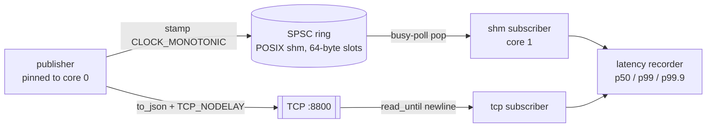
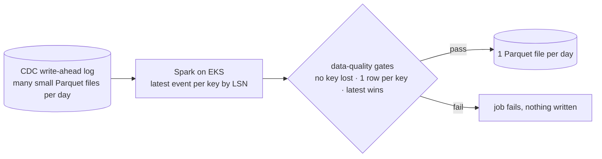

<!-- Generated parts: assets/*.svg and the upstream table are rebuilt by scripts/build_profile.py.
     Edit data/career.json or this file, not the SVGs. -->

<h1 align="center">Harsh Kumar Panchal</h1>

  <b>Backend and data engineer.</b> At work I move data: CDC logs into Parquet, with Spark on Kubernetes. 
  On my own I move bytes: a lock-free ring buffer in C++, concurrent object models in Java, a sharded cache in Go. 
  Data Engineering Intern @ Fam · CS @ Scaler School of Technology · B.Sc. CS, BITS Pilani · Bengaluru

  
  
  
  

<picture>
  <source media="(prefers-color-scheme: dark)" srcset="assets/trace-dark.svg">
  
</picture>

My career drawn as a distributed trace. At RagaAI I fixed a trace timeline that collapsed microsecond spans into one-second buckets, so this felt like the right format. The green span is still running.

## Now

At **Fam** I work on the data platform's move to a lakehouse (S3, Iceberg, Trino):

- a **Spark job on EKS**, run by Airflow, that compacts the CDC write-ahead log into one Parquet file per day. It keeps the latest event per key by LSN, checks data-quality invariants before every write, and gives the same output on a rerun.
- a **multi-user JupyterHub on Kubernetes** (Helm, Karpenter, Pulumi): one pod per analyst, JumpCloud login, and read-only Trino access where every query is tagged with the user's email.

## Measured, not claimed

<a href="https://github.com/harshpanchal04/Market-Data-System-HFT">
<picture>
  <source media="(prefers-color-scheme: dark)" srcset="assets/latency-dark.svg">
  
</picture>
</a>

Every Monday, CI clones <a href="https://github.com/harshpanchal04/Market-Data-System-HFT">Market-Data-System-HFT</a>, compiles it, runs <code>scripts/bench.sh</code> (a publisher and two subscribers on one runner) and redraws this card from the output. GitHub runners are shared VMs, so compare the two paths, not the absolute numbers.

## Claims, with receipts

| Claim | Where to check it |
|---|---|
| Lock-free single-producer/single-consumer ring buffer, read and write indices on separate cache lines | [`spsc_queue.hpp`](https://github.com/harshpanchal04/Market-Data-System-HFT/blob/main/include/core/spsc_queue.hpp) |
| Nearest-rank latency percentiles on `CLOCK_MONOTONIC`, plus a regression test for a shared-memory bug I shipped and then fixed | [`latency_recorder.hpp`](https://github.com/harshpanchal04/Market-Data-System-HFT/blob/main/include/util/latency_recorder.hpp) · [`test_tick_data.cpp`](https://github.com/harshpanchal04/Market-Data-System-HFT/blob/main/tests/test_tick_data.cpp) |
| Sharded in-memory cache with TTL, eviction under a memory cap, Prometheus metrics (Go) | [`key_value_cache.go`](https://github.com/harshpanchal04/key-value-cache/blob/main/key_value_cache.go) |
| Idempotency keys and atomic stock decrement on order placement | [`app.py`](https://github.com/harshpanchal04/inventory-order-service/blob/main/app.py) · [`DECISIONS.md`](https://github.com/harshpanchal04/inventory-order-service/blob/main/DECISIONS.md) |
| Parking lot with 6 GoF patterns and zero class inheritance; its race condition is written up | [`LLD-Parking-Lot`](https://github.com/harshpanchal04/LLD-Parking-Lot#thread-safety-analysis) |
| 10-stage CI: Flake8, CodeQL, OWASP Dependency-Check, pytest, Docker smoke test, Trivy | [`ci.yml`](https://github.com/harshpanchal04/ReserveX/blob/main/.github/workflows/ci.yml) |
| Offline Ed25519 signature checks with 30-second rotating QR challenges | [`crypto-utils`](https://github.com/harshpanchal04/AuthX/blob/main/packages/crypto-utils/src/index.ts) |
| Hybrid BM25 + dense retrieval fused with Reciprocal Rank Fusion (k = 60) | [`search.py`](https://github.com/harshpanchal04/Organizational-Reasoning-Engine/blob/main/src/retrieval/search.py) |

## Projects

| | Project | The interesting part |
|:-:|---|---|
| ⚡ | **[Market-Data-System-HFT](https://github.com/harshpanchal04/Market-Data-System-HFT)** C++17 · POSIX shm · Boost.Asio | The same tick goes over a lock-free ring in shared memory and over TCP + JSON, and both are timed on one clock. Measuring it exposed two bugs of mine: a read-only mapping the consumer wrote to, and a cached clock that was only accurate to 1 ms. |
| 🗃️ | **[key-value-cache](https://github.com/harshpanchal04/key-value-cache)** Go · Prometheus | Sharded map to cut lock contention, TTL expiry, and eviction once a memory cap is hit |
| 🧩 | **[LLD in Java](https://github.com/harshpanchal04/LLD-Parking-Lot)** Java 11 · GoF · SOLID | Parking lot, [ATM](https://github.com/harshpanchal04/LLD-ATM-Solution) and [Snake & Ladder](https://github.com/harshpanchal04/Snake-Ladder-): strategies you can swap at runtime, a State-pattern slot lifecycle, `AtomicLong` ticket IDs |
| 🚆 | **[ReserveX](https://github.com/harshpanchal04/ReserveX)** Python · K3s · AWS EC2 | Greedy interval stitching that chains partial seat vacancies into full journeys, shipped through a 10-stage CI pipeline and CD to K3s |
| 📊 | **[Impactra](https://impactra.vercel.app/)** Node.js · Redis · BullMQ · Postgres | Queue-backed workers that score PR diffs, with Postgres caching to stay under GitHub and LLM rate limits; ranked 1,200+ student profiles at Chitkara University |
| 🔐 | **[AuthX](https://github.com/harshpanchal04/AuthX)** TypeScript · Ed25519 | The guard app verifies signed, rotating QR codes with no network, so entry works when the Wi-Fi doesn't |
| 🧠 | **[TrustLoop](https://github.com/harshpanchal04/TrustLoop)** · **[Org Reasoning Engine](https://github.com/harshpanchal04/Organizational-Reasoning-Engine)** LangGraph · retrieval | Agents that route low-confidence answers to a human, and learn from expert feedback without fine-tuning |

<b>How two of these work (click to expand)</b>

 

**Market data: one tick, two transports**

Bugs I found by measuring it: the consumer mapped the segment `PROT_READ` but `pop()` writes the read index, so the first message crashed it. The cached clock refreshed every 1 ms, so per-message latencies were noise. A subscriber that slept after 1,000 empty polls added the OS wake-up time to every tick. Each fix has a test or a benchmark that shows it.

**CDC log compaction (the pattern, at work)**

De-duplicate within a day, never across days: a key that changed on two days has to appear in both day folders, or the incremental job for the earlier day misses the change.

## Upstream

<!-- upstream:start -->
| merged | repo | pull request |
|---|---|---|
| 2026-08-13 | `freeCodeCamp-Summer-Cohort-2026/datalens` | [#31 feat: add --verbose flag to datalens clean command](https://github.com/freeCodeCamp-Summer-Cohort-2026/datalens/pull/31) |
| 2025-04-17 | `aristotle-ai/RagaAI-Catalyst` | [#128 Create Quickstart.md](https://github.com/aristotle-ai/RagaAI-Catalyst/pull/128) |
| 2024-09-26 | `Vishesh-Paliwal/Shatranj` | [#5 Implemented Queen Piece moveTo method](https://github.com/Vishesh-Paliwal/Shatranj/pull/5) |
<!-- upstream:end -->

My RagaAI internship work on <a href="https://github.com/raga-ai-hub/RagaAI-Catalyst">RagaAI Catalyst</a> (16K★): the test infrastructure and the integrations for 7 agent frameworks were merged through team branches, so it isn't listed under my name.

## Toolbox

  

Data: Apache Spark · Airflow · Trino · Iceberg · Parquet · Snowflake. Infra: EKS · Helm · Karpenter · Pulumi.

---

This page rebuilds itself every Monday. <a href=".github/workflows/profile.yml"><code>profile.yml</code></a> compiles and benchmarks my C++ project on the runner, then <a href="scripts/build_profile.py"><code>build_profile.py</code></a> (standard-library Python) redraws the trace and latency cards and refreshes the upstream list from the GitHub API.
